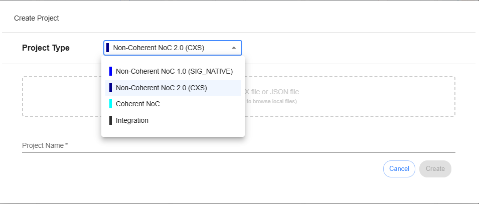
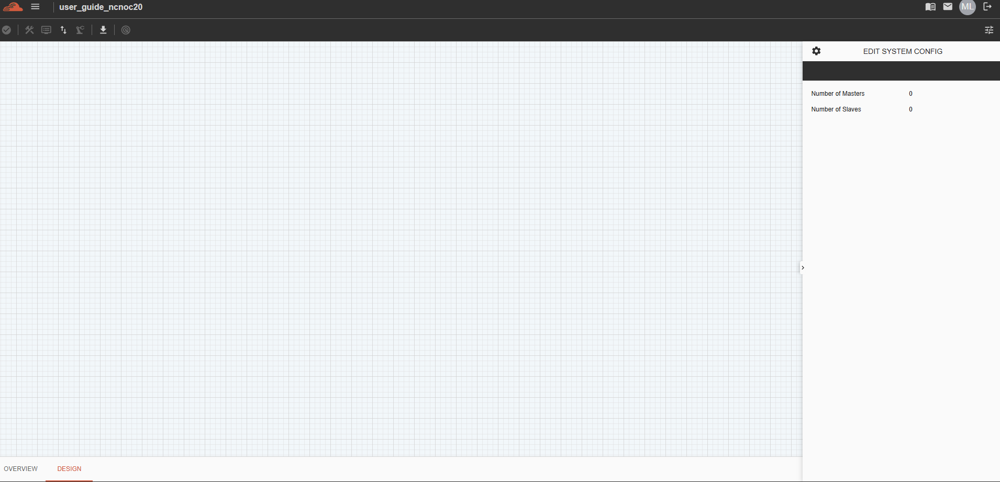

===================================================
Creating Non-Coherent NoC Project with CXS 
===================================================

The **Create Project** workflow initializes a clean workspace tailored for **Non-Coherent NoC 2.0 (CXS)** topologies utilizing CXS packet transport. This configuration loads high-throughput streaming credit-based interfaces and non-coherent transport bridges for systems that do not require hardware-managed cache coherency.

--------------------------------------------------------------------------------

Project Settings Configuration Options
=========================================

The Project Settings wizard panel allows you to configure essential design rules and data sources before generating your hardware canvas layout.

.. list-table:: Project Configuration Form 
   :widths: 25 25 50
   :header-rows: 1

   * - Field Parameter
     - Setting Input Type
     - Description & Platform Entry Constraints
   * - **Project Type**
     - Dropdown Selector
     - Selects the target fabric architecture. Options include:
       
       * **Non-Coherent NoC 1.0 (SIG-NATIVE)** — Activates memory-mapped routing.
       * **Non-Coherent NoC 2.0 (CXS)** — Activates CXS packet transport. 
       * **Coherent NoC** — Toggles cache-coherent (CHI) structures.
       * *Integration* — *(Currently not implemented).*
   * - **Project Name**
     - String Input Block
     - **Required Field.** Enter a unique layout identifier name. 
       
       *(Subject to strict naming constraints below).*

--------------------------------------------------------------------------------

String & Naming Validation 
=========================================

The database registration engine enforces strict validation rules on the project name field. Input strings failing these constraints will trigger submission blocks:

.. warning::
   **Project Naming Constraints:**
   
   * **Space Prohibition:** Whitespace characters are strictly forbidden anywhere inside the project name string field (e.g., use ``My_NC_NoC`` or ``MyNCNoC`` instead of ``My NC NoC``).
   * **Allowed Characters:** The input processor handles standard **alphanumeric characters only**. Special symbols, punctuation marks, and mathematical operators are completely prohibited.

--------------------------------------------------------------------------------

Launching Your Workspace
========================================

Once you have verified and entered the project name, check the **Design** tab to see the topology. 

