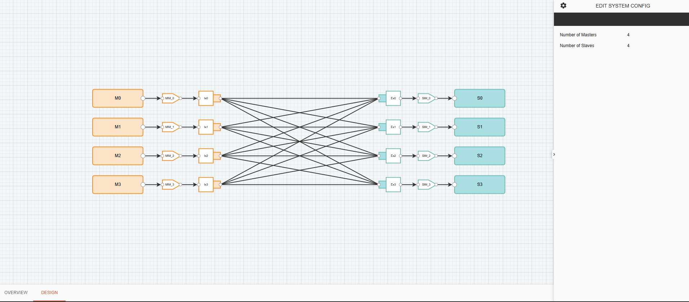
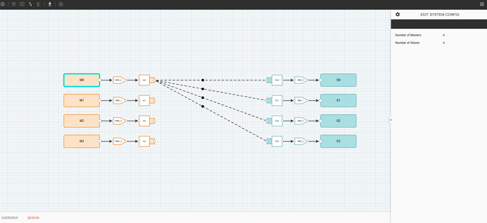

==========================================
Non-Coherent NoC 2.0 (CXS) Sample Design
==========================================

Below is a sample design with Non-Coherent NoC 2.0 (CXS), assuming that all necessary configuration and parameters are completed and all validations are passed. 

To view the connectivity, click any Initiator or Target Component. 

.. note::
   If the connectivity for either direction is set to "Disconnected," no corresponding line connections will appear in the Design tab. Ensure that valid connectivity is configured for each component.
