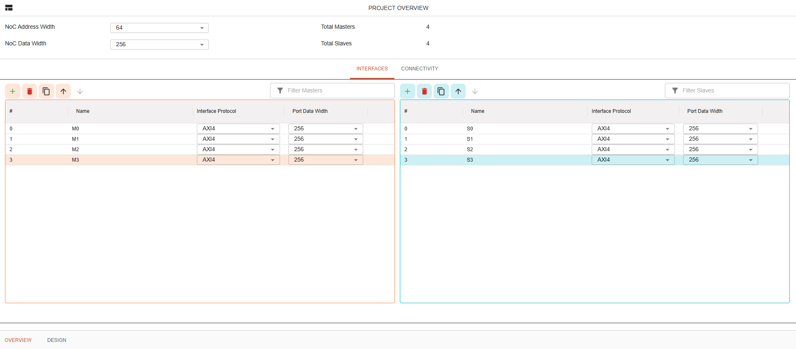
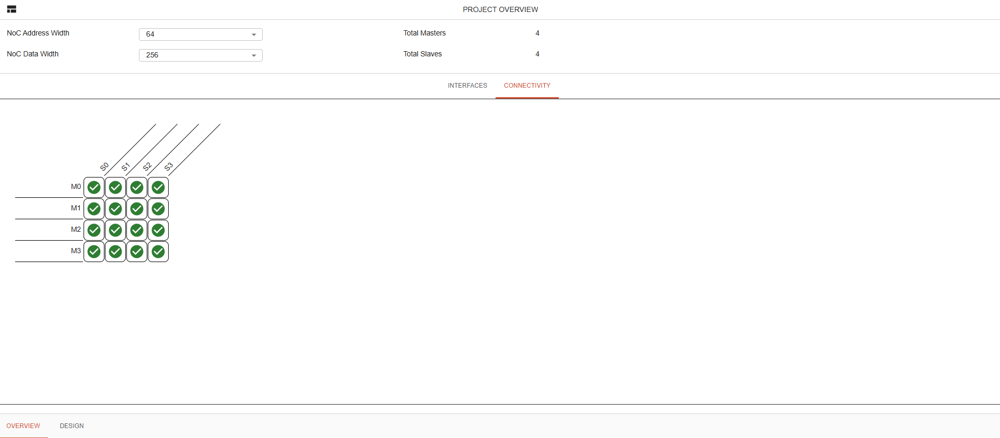

NC-NoC Project Overview with CXS
====================================================

The Project Overview allows you to configure global network settings and manage device communication interfaces. Use the Interface tab to add design components, define interface protocols and port data widths, and set the corresponding NoC data and address widths.

Interface Tab (CXS)
----------------------

**Global Network Settings:** Define top-level parameters such as NoC Address Width, NoC Data Width, and the Preferred Network Configuration

**Ingress Devices (Left Panel):** Configure incoming data sources by assigning Ingress IDs, names, Interface Protocols (e.g., AXI4, SIG_NATIVE), and Port Data Widths.

**Egress Devices (Right Panel):** Manage outgoing destinations by specifying Egress IDs, target names, security settings, and communication protocols (e.g., AXI4, AXI3) with corresponding port widths.

**Actions:** Use the toolbar buttons to add or remove interfaces, filter lists, and apply changes using the Reconfigure or Reset Changes options at the bottom.

Connectivty Tab (CXS)
---------------------------

**Matrix View:** Visualize and manage communication pathways between all configured ingress devices (rows) and egress targets (columns).

**Connection Toggle:** Use the interactive checkmark grid to enable or disable routing paths between specific initiators (e.g., axinorm_mst, axirm_mst) and targets (e.g., Default_Target_0, axirm_slv1, axinorm_slv2).

**Global & Action Controls:** Maintain access to the top-level NoC Address Width, NoC Data Width, and Preferred Network Configuration settings, with final layout updates applied via the Reconfigure button.

