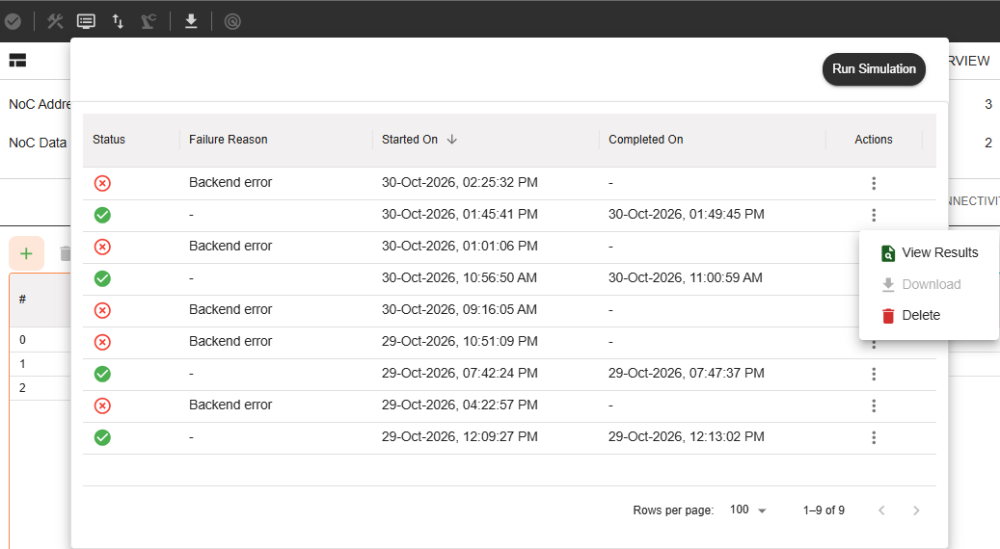

===============================
NC-NoC 2.0 (CXS) Simualation 
===============================

The Simulation Engine for NC-NoC 2.0 CXS provides a cycle-accurate validation workspace to analyze the ultra-low-latency streaming performance, FLIT-level credit management, and end-to-end flow control of your CXS topologies. This layer enables you to stress-test high-density, multi-die stream interfaces against rigorous credit-starvation scenarios and dynamic traffic patterns.
Simulating CXS topologies allows you to accurately measure link utilization and optimize credit allocation, catching structural bottlenecks and bridge-level protocol errors before generating the synthesizable RTL.

-----------------------------------------------------------------------

Core Verification Objectives:
===============================

.. list-table:: Test Execution 
   :widths: 25 75
   :header-rows: 1
   :stub-columns: 1 

* - Flow Control & Credit Management: 
  - Verifies FLIT-level credit exchange mechanics and ensures recovery from credit-starvation states.
* - Throughput Optimization:
  - Measures streaming interface efficiency and end-to-end link latency across multi-die or chiplet boundaries.
* - Structural Bottleneck Isolation: 
  - Identifies routing congestion points caused by heavy, concurrent CXS packet streams.

--------------------------------------------------------------------------------

Managing Test Runs
====================

Once configuration parameters match your target profiling constraints, click the primary **Run Simulation** button to bundle your design files and dispatch the job container to the verification cluster.

The system logs active builds directly inside the trace tracking layout table, recording critical parameters across the entire simulation runtime lifecycle:

Status Trace
   Renders real-time execution states (e.g., ``Pending``, ``Running``, ``Passed``, or ``Failed``) straight from the build server.

Timestamps
   Logs exact start and completion dates to let teams benchmark structural compile times between different design variations.

Action Controls
   Click the **Ellipsis Action Column** items to interact with compiled log assets:

   * **View Results:** PDF View of the results with all the Performance Summary, Run files results, Latency and the supported tests. 
   * **Download:** Packages and pulls down the compiled transaction log matrices, performance data, and waveform traces straight to your workstation downloads folder *(availability governed by group license limits)*.
   * **Delete:** Permanently purges the targeted validation folder container from your history log to clean up your workspace footprint.

